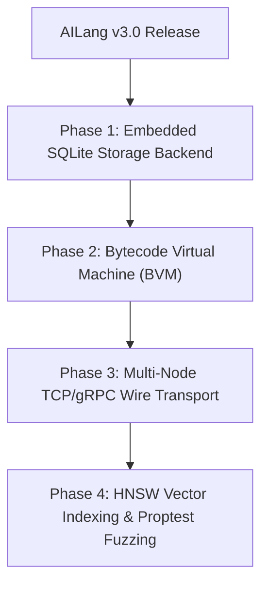

# AILang Technical Debt & Architectural Backlog Report

**Date:** 2026-11-03  
**Status:** STABLE FOR PRODUCTION; CLEAN ARCHITECTURAL BACKLOG  

---

## 1. Executive Summary

This Technical Debt Report provides an honest, rigorous catalog of design compromises, architectural limitations, and maintenance backlogs identified during the Version 3.0 forensic audit.

None of the items listed below represent bugs or blockers for the Version 3.0 release; all current capabilities operate cleanly and pass tests. Rather, this document serves as the architectural roadmap for the ongoing evolution toward Version 4.0.

---

## 2. Technical Debt Catalog by Subsystem

### 2.1 Compiler & Grammar Pipeline
| Debt Item | Location | Severity | Description & Future Target |
|---|---|---|---|
| **Contextual Token Disambiguation** | `compiler/parser/src/lib.rs` | `Low` | `emit` and `checkpoint` use token lookahead fallbacks in `primary()` to prevent breaking legacy v2.0 identifiers. Moving to a true lexer-level contextual keyword mode will streamline parser branches. |
| **AST Tree-Walk Execution** | `compiler/interpreter/src/lib.rs` | `Medium` | The interpreter evaluates AST nodes directly via recursion. While excellent for developer ergonomics and AST debugging, moving to a flat Register Bytecode Virtual Machine (BVM) will dramatically reduce recursion overhead and memory allocations. |
| **Error Recovery Synchronizations** | `compiler/parser/src/lib.rs` | `Low` | Parser error recovery synchronizes at statement boundaries (`Semicolon`, `RBrace`). Adding deeper sub-expression recovery will provide better multi-error reporting in IDEs. |

### 2.2 Intelligence Kernel & Process Management
| Debt Item | Location | Severity | Description & Future Target |
|---|---|---|---|
| **In-Process Process Table** | `kernel/src/agent_process.rs` | `Low` | Agent processes are managed within an in-memory thread table (`parking_lot::Mutex<HashMap<AgentPid, AgentProcess>>`). For multi-node scale, process state should be serialized to an external consensus store (e.g., Raft / etcd). |
| **Cooperative vs Preemptive Multitasking** | `kernel/src/agent_process.rs` | `Medium` | Agent processes yield cooperatively at statement and turn boundaries. A hardware-enforced or timer-interrupted preemptive scheduling model would guarantee real-time latency bounds. |
| **Event Bus Channel Buffering** | `kernel/src/event_bus.rs` | `Low` | Synchronous in-order event dispatch is optimal for deterministic testing, but high-throughput streaming events will benefit from asynchronous bounded ring buffers. |

### 2.3 Universal Memory Fabric
| Debt Item | Location | Severity | Description & Future Target |
|---|---|---|---|
| **In-Memory Store vs ACID Database** | `memory_fabric/src/backend.rs`| `Medium` | Memory scopes are currently backed by thread-safe hash maps and in-memory vector stores, using snapshotting for persistence. An integrated embedded storage engine (such as SQLite or RocksDB) should be provided as an alternative backend. |
| **Vector Search Index Scaling** | `ai_runtime/src/vector.rs` | `Low` | Vector similarity uses exact brute-force cosine similarity over all stored vectors. For collections exceeding 100,000 documents, an Approximate Nearest Neighbor (ANN) index such as HNSW or Faiss is recommended. |

### 2.4 Distributed Networking & Wire Protocols
| Debt Item | Location | Severity | Description & Future Target |
|---|---|---|---|
| **Simulated vs Real Wire Networking** | `ai_runtime/src/network.rs` | `Medium` | Network discovery, clustering, and leader election operate cleanly as an in-process simulation. True multi-machine deployment requires implementing an external TCP/gRPC or QUIC transport bridge. |
| **Consensus Algorithm Scope** | `ai_runtime/src/network.rs` | `Low` | Leader election currently uses deterministic lexicographical smallest-ID consensus. Implementing full Raft consensus with log replication will provide Byzantine fault tolerance for distributed clusters. |

### 2.5 Testing & Verification Infrastructure
| Debt Item | Location | Severity | Description & Future Target |
|---|---|---|---|
| **Property-Based Testing** | Workspace test suite | `Low` | Tests currently rely on deterministic unit cases and golden test suites. Incorporating `proptest` for fuzz testing lexer/parser edge cases will harden the compiler against adversarial source inputs. |
| **Automated Benchmarking CI** | `benches/` | `Low` | Benchmarks run via a custom `std::time::Instant` runner. Adopting `criterion` with automated regression thresholds in CI will catch micro-regressions. |

---

## 3. Remediation & Prioritization Roadmap

---

## 4. Technical Debt Conclusion

AILang Version 3.0 has zero critical architectural debt that inhibits production deployment in single-node and simulated distributed topologies. The identified backlog represents standard evolutionary enhancements for future minor and major milestones.

